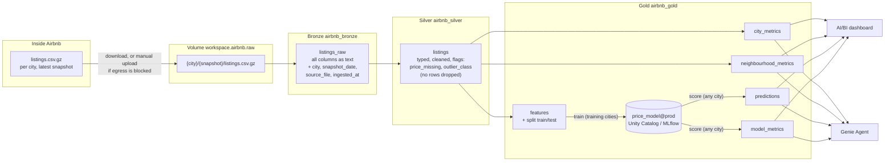

# Solution architecture



| layer | what | why |
|---|---|---|
| Volume | the raw file exactly as downloaded, one folder per city and snapshot | reproducible input; works when Free Edition blocks the download (manual upload) |
| Bronze | the CSV read as text plus lineage columns | nothing can fail on types here; we can always re-derive silver |
| Silver | typed and cleaned listings; problems flagged, not dropped | one trustworthy listing table for analysis, dashboard and features |
| Gold | aggregates, model features, predictions and metrics | what the dashboard, Genie and the model consume |

**Job `airbnb_pipeline`** (one definition, city is a parameter):

```
etl_per_city (for each city in `cities`) → should_train? → train (train_cities) → score_per_city (for each city)
   01_etl_city: ingest → bronze → silver → gold metrics → features
```

Every write replaces only the rows of its city (`replaceWhere city = ...`), so cities can be re-run independently.
Adding a city = one entry in `config/cities.yml` + running the job with that city; no code is copied.
